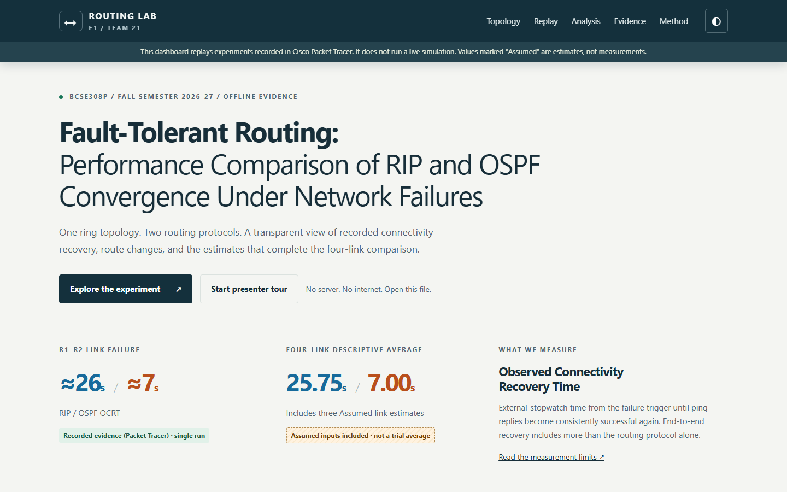
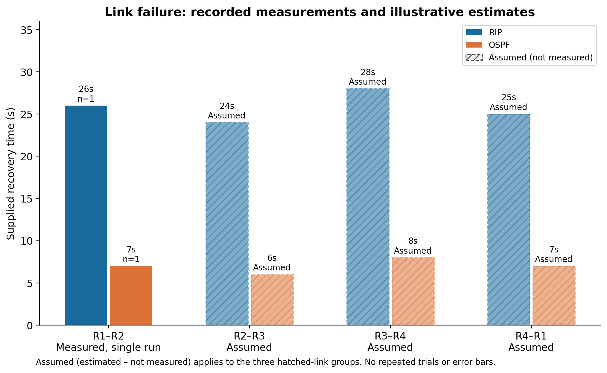

# Fault-Tolerant Routing

## Performance Comparison of RIP and OSPF Convergence Under Network Failures

A Computer Networks Lab project comparing RIPv2 and single-area OSPF on the same four-router ring in Cisco Packet Tracer. An offline dashboard presents recorded routing behaviour, original screenshots, comparison graphs and clearly labelled illustrative estimates.

**Course:** BCSE308P · **Institution:** VIT Vellore · **Semester:** Fall 2026–27 · **Slot:** F1 · **Team:** 21

**Faculty:** Dr. Sreethar S, Associate Professor Grade 1

| Register number | Team member | Programme | Contribution |
| --- | --- | --- | --- |
| 24BCE2479 | Harshith Reddy V | B.Tech Computer Science and Engineering | Topology, IP addressing, RIP configuration, report Chapters 1–3 |
| 24BDS0352 | Sinchana B Kurkuri | B.Tech Computer Science and Engineering (Data Science) | OSPF configuration, dashboard, graphs, report Chapters 4–6 |

[GitHub repository](https://github.com/Sinchana-B-Kurkuri/Fault-Tolerant-Routing-Performance-Comparison-of-RIP-and-OSPF-Convergence-Under-Network-Failures)



The dashboard is an evidence replay. It does not run routing protocols or generate live simulation results. Its diagrams and animations are illustrative; the original Packet Tracer screenshots are identified separately.

## Start the dashboard

### Open directly

Download or clone the complete project, then open **[Dashboard/index.html](Dashboard/index.html)** in a modern browser. All scripts, images and Chart.js assets are local. The dashboard works offline without installation or a server.

### Open through localhost

Open a terminal in the project root, where this README is located, and run:

```powershell
python -m http.server 8765 --bind 127.0.0.1
```

Open **[http://localhost:8765/Dashboard/index.html](http://localhost:8765/Dashboard/index.html)** in Chrome, Edge or another modern browser. Press **F11** for full screen. Keep the terminal running while using this link; press **Ctrl+C** to stop the server.

If Windows uses the Python launcher, use `py -m http.server 8765 --bind 127.0.0.1` instead. If port 8765 is occupied, choose another port in both the command and URL. The server only serves the existing static files.

### Dashboard controls

- Select **RIP** or **OSPF**, choose a scenario, and advance through its before, failure and recovered-path steps.
- Click a topology device to inspect its addresses and saved protocol information.
- Use **Show assumed values** to switch between the full supplied comparison and recorded link measurements only.
- Filter the evidence library by protocol or experiment. Open an image to enlarge it; use left/right arrows and Esc in the lightbox.
- Use the presenter tour, colour theme and responsive layouts. Reduced-motion preferences are supported.

## Final report and presentation

All final documents are together in **[Documents](Documents/)**:

| File | Contents |
| --- | --- |
| [Project report — Word](Documents/F1_Team21_Final_Project_Report.docx) | Final editable report, official certificate and appendices |
| [Project presentation](Documents/F1_Team21_Final_Project_Presentation.pptx) | Editable 12-slide presentation with charts, tables and speaker notes |
| [GitHub and working model verification](Documents/F1_Team21_GitHub_and_Working_Model_Verification.docx) | Repository URL, execution steps, screenshot walkthrough and evidence descriptions |

## Project structure

```text
CN Project/
├── Dashboard/                  Offline HTML, CSS, JavaScript and local assets
│   ├── assets/screenshots/      37 original Packet Tracer evidence images
│   ├── css/                    Dashboard styles
│   ├── js/                     Interface logic and local data mirror
│   └── vendor/                 Chart.js and its licence
├── Configs/                    Eight saved router configuration exports
├── Data/                       Results, evidence manifest and final charts
├── Documents/                  Final report, presentation and verification document
├── Scripts/                    Analysis, data validation and browser checks
├── Testing/                    Dashboard screenshots and verification results
├── v1_topology_base.pkt         Original topology stage
├── v2_rip.pkt                   Original RIPv2 simulation
├── v3_ospf.pkt                  Original OSPF simulation
└── README.md
```

The complete source is supplied. The project needs no database or compiled application. The original `.pkt` files remain at the root so the existing validation and network-file references continue to work.

## Software requirements

| Purpose | Requirement |
| --- | --- |
| View dashboard directly | Modern browser; no Python, Node or internet required |
| Localhost preview | Python 3 and its standard-library HTTP server |
| Open network simulations | Cisco Packet Tracer 9.x; all saved headers identify **9.0.1.0858** |
| View documents | DOCX/PPTX-compatible office application and a PDF reader |
| Regenerate static graphs | Python 3.12 and [Scripts/requirements.txt](Scripts/requirements.txt) |
| Validate data | Python 3 standard library |
| Optional browser checks | [Scripts/requirements-test.txt](Scripts/requirements-test.txt) and Playwright Chromium |

Designated test system: Intel Core Ultra 5 125H, 16,568,156,160 bytes reported RAM, approximately 16 GB installed class, and 64-bit Windows 11 Home Single Language, version 10.0.26300.

## Network topology and addressing

The topology is **R1–R2–R3–R4–R1**, with no diagonal. Four Cisco 2911 routers each connect through a Cisco 2960-24TT switch to a PC-PT. A single ring-link failure leaves an alternate route between surviving routers. A failed router's own LAN has no redundant gateway.

| Link | Endpoint 1 | Endpoint 2 | Transit subnet |
| --- | --- | --- | --- |
| R1–R2 | R1 G0/0 — 10.0.12.1 | R2 G0/0 — 10.0.12.2 | 10.0.12.0/30 |
| R2–R3 | R2 G0/1 — 10.0.23.1 | R3 G0/0 — 10.0.23.2 | 10.0.23.0/30 |
| R3–R4 | R3 G0/1 — 10.0.34.1 | R4 G0/0 — 10.0.34.2 | 10.0.34.0/30 |
| R4–R1 | R4 G0/1 — 10.0.41.1 | R1 G0/1 — 10.0.41.2 | 10.0.41.0/30 |

| LAN | Router G0/2 and default gateway | PC address | Mask |
| --- | --- | --- | --- |
| 192.168.1.0/24 | 192.168.1.1 | PC1 — 192.168.1.10 | 255.255.255.0 |
| 192.168.2.0/24 | 192.168.2.1 | PC2 — 192.168.2.10 | 255.255.255.0 |
| 192.168.3.0/24 | 192.168.3.1 | PC3 — 192.168.3.10 | 255.255.255.0 |
| 192.168.4.0/24 | 192.168.4.1 | PC4 — 192.168.4.10 | 255.255.255.0 |

Transit mask: `255.255.255.252`. Saved-file inspection verified interface addresses and PC gateways.

## Saved routing configurations

Open the `.pkt` files separately in Packet Tracer. Preserve the originals during any later experiment.

- **v1_topology_base.pkt:** no dynamic routing process. Running/startup state differs, so treat it as the topology stage rather than assuming reload behaviour.
- **v2_rip.pkt:** RIPv2 only on all four routers, `version 2`, `no auto-summary`, `network 10.0.0.0` and the local LAN network.
- **v3_ospf.pkt:** OSPF only, process 1, area 0, `network 10.0.0.0 0.255.255.255 area 0` and the local LAN /24 match. No explicit `router-id` is saved.

Running and startup configurations match in both protocol files. Exact exports are in [Configs](Configs/); [Configs/PACKET_TRACER_VERIFICATION.md](Configs/PACKET_TRACER_VERIFICATION.md) explains the inspection and its limits. Guide-intended commands are distinguished from verified saved commands.

Optional device checks: `show running-config`, `show ip protocols`, `show ip route` and, for OSPF, `show ip ospf neighbor`. Saved-file inspection establishes persisted configuration, not a fresh experiment or independent verification of historical stopwatch timings.

## Scenarios and measurement method

| Case | Traffic and action | Recorded observation |
| --- | --- | --- |
| A — link failure | PC1 to PC2; shut R1 G0/0, the R1–R2 link | Alternate R1–R4–R3–R2 route; RIP metric 1 to 3 and OSPF cost 2 to 4 |
| B — router failure | PC1 to PC3; R4 off | Surviving route through R2; RIP metric 2 and OSPF cost 3 remain unchanged |
| C — restoration | Restore R1–R2 | Preferred route returns; OSPF replies change TTL 124 to 126 |

**Observed Connectivity Recovery Time (OCRT)** is external-stopwatch wall time from failure introduction until ping replies become consistently successful: the first successful reply followed by another consecutive successful reply. Ping RTT, timeout counts and route-age fields are not timing substitutes. Timings come from CNPj34.docx result tables; original screenshots corroborate visible routing and ping behaviour.

> Convergence values reported in this project are Observed Connectivity Recovery Times, measured via external stopwatch against Packet Tracer's simulated continuous ping — not laboratory-grade, isolated routing-protocol convergence measurements. They include human stopwatch reaction time (approx. 0.3–1 second), Packet Tracer's own simulation/event-processing delay, and end-to-end effects (link-down detection, routing recalculation, ARP refresh) rather than pure routing-protocol convergence alone. The metric remains valid for comparing RIP and OSPF because the identical method is applied to both, under identical topology and failure conditions.

The quoted identical-conditions statement does not make Case B's earlier/later runs directly comparable. The restoration TTL/path-change interval is distinct from outage OCRT. No new network experiments were performed during dashboard development or repository organisation.

## Results and performance analysis

| Failed link | RIP | OSPF | Shorter OSPF time | Input status |
| --- | --- | --- | --- | --- |
| R1–R2 | 26 s | 7 s | 73.08% | Recorded, single run per protocol |
| R2–R3 | 24 s | 6 s | 75.00% | Assumed estimate, not measured |
| R3–R4 | 28 s | 8 s | 71.43% | Assumed estimate, not measured |
| R4–R1 | 25 s | 7 s | 72.00% | Assumed estimate, not measured |



Solid bars show recorded R1–R2 observations. Hatched bars show **Assumed (estimated – not measured)** inputs. Derived comparisons retain their inputs' status.

Across all four supplied links, including three assumed-link estimates:

| Descriptive statistic | Value |
| --- | --- |
| RIP arithmetic average | 25.75 s |
| OSPF arithmetic average | 7.00 s |
| Difference of averages | 18.75 s |
| Reduction of averages | 72.82% |
| Ratio of averages, RIP / OSPF | 3.68× |

Reduction = `(RIP − OSPF) / RIP × 100`. Ratio = `RIP / OSPF`. Four-link averages divide each protocol's four supplied times by four. These describe mixed recorded and assumed cases, not repeated-trial averages. No standard deviation, confidence interval, error bars or statistical significance is claimed.

- **R4 failure:** RIP's later run reports approximately 11 s. OSPF's earlier run shows no observed loss, so OCRT is not measurable. This is not a zero-second measurement; the runs do not support direct protocol ranking.
- **Restoration:** both original routes returned. RIP timing was unreliable. OSPF's approximately 11 s refers to TTL/path return, not outage OCRT.
- **Packet loss:** no completed ping summary establishes totals or percentages. **E22** remains unconfirmed and excluded as restoration proof.

Opposite-LAN routes have equal-cost alternatives. Traffic already using R2 is a possible, unverified explanation for the earlier OSPF no-loss observation. Repeated matched experiments, individual timing of every link and automated timestamps are needed for stronger conclusions.

## Data and source code

| Path | Purpose |
| --- | --- |
| `Dashboard/index.html` | Sections, controls, chart canvases and evidence dialog |
| `Dashboard/css/style.css` | Responsive presentation, status styling, focus and reduced motion |
| `Dashboard/js/app.js` | Scenario selection, illustrative paths, charts, filters and lightbox |
| `Dashboard/js/data.js` | Local data mirror supporting direct offline opening without fetch |
| `Data/results.csv` and `results.json` | Canonical supplied results and recorded/assumed status |
| `Data/summary_statistics.csv` | Derived comparisons and mixed-input arithmetic |
| `Data/evidence_manifest.csv` | All 37 source images, descriptions, confidence and hashes |
| `Scripts/generate_charts.py` | Six reproducible PNG/SVG figures |
| `Scripts/validate_data.py` | Mirrors, arithmetic, evidence hashes and configurations |
| `Scripts/test_dashboard.py` | Optional browser, offline and responsive checks |

See [Data/README.md](Data/README.md) for provenance and [Testing/README.md](Testing/README.md) for verification results and scope.

## Validation and chart regeneration

From the project root:

```powershell
python Scripts/validate_data.py
```

To regenerate static charts:

```powershell
python -m pip install -r Scripts/requirements.txt
python Scripts/generate_charts.py
```

Expected: zero validation failures and six PNG/SVG pairs in `Data/charts/`. Dashboard use requires none of these Python packages.

Optional browser checks:

```powershell
python -m pip install -r Scripts/requirements-test.txt
python -m playwright install chromium
python Scripts/test_dashboard.py
```

These open the dashboard through `file://`, block remote runtime requests, exercise controls and evidence, and check responsive layouts. An available Firefox executable is also attempted; unavailable browsers are reported as skipped. Logs and screenshots are written to `Testing/`.

## Share or upload the project

Share the complete project folder or the prepared teammate ZIP. The ZIP includes source, local assets, all three simulations, final documents, configurations, data and testing evidence. It excludes local Git history and temporary development files.

After extraction, open the directory containing this README and follow the direct-open or localhost instructions. To upload to another GitHub repository, upload that directory's contents, retaining relative paths and all assets. Screenshots alone are insufficient for verification.

## References

1. G. Malkin, *RIP Version 2*, RFC 2453, 1998. [RFC Editor](https://www.rfc-editor.org/info/rfc2453/)
2. J. Moy, *OSPF Version 2*, RFC 2328, 1998. [RFC Editor](https://www.rfc-editor.org/info/rfc2328/)
3. C. Hedrick, *Routing Information Protocol*, RFC 1058, 1988. [RFC Editor](https://www.rfc-editor.org/info/rfc1058/)
4. Cisco, *Cisco IOS IP Routing RIP Command Reference*. [Cisco documentation](https://www.cisco.com/c/en/us/td/docs/ios/iproute_rip/command/reference/irr_book/irr_rip.html)
5. Cisco, *IP Routing OSPF Configuration Guide Cisco IOS XE Release 2*. [Cisco documentation](https://www.cisco.com/c/en/us/td/docs/ios-xml/ios/iproute_ospf/configuration/xe-2/iro-xe-2-book.pdf)
