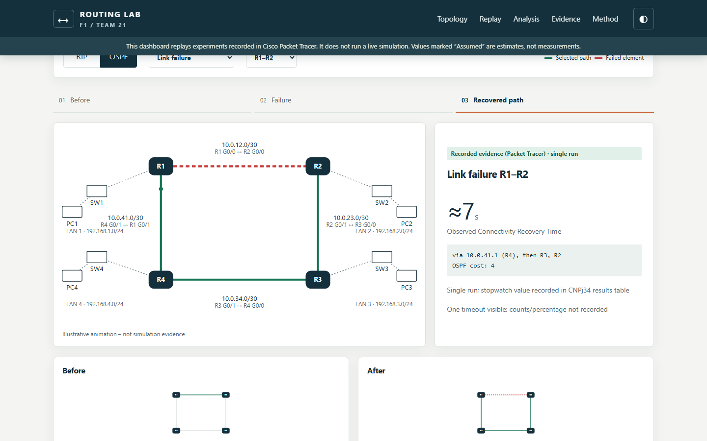

# Fault-Tolerant-Routing-Performance-Comparison-of-RIP-and-OSPF-Convergence-Under-Network-Failures

An offline evidence presentation for **Fault-Tolerant Routing: Performance Comparison of RIP and OSPF Convergence Under Network Failures**, BCSE308P, VIT Vellore, Fall Semester 2026-27. Slot **F1**, Team **21**. Faculty: **Dr. Sreethar S, Associate Professor Grade 1**.

| Register number | Member | Branch | Responsibility |
| --- | --- | --- | --- |
| 24BCE2479 | Harshith Reddy V | B.Tech Computer Science and Engineering | Topology, IP addressing, RIP configuration, report Chapters 1–3 |
| 24BDS0352 | Sinchana B Kurkuri | B.Tech Computer Science and Engineering (Data Science) | OSPF configuration, dashboard, graphs, report Chapters 4–6 |

## Description and objectives

Compare recorded RIPv2 and OSPF behaviour on the same four-router ring, preserve failure/restoration evidence, distinguish measured values from illustrative estimates, and make the methodology and code easy to demonstrate. No new routing protocol was developed.

## Run the dashboard

Double-click **Dashboard/index.html**. It works through `file://` in a modern browser, offline, without installation or a server. All assets and Chart.js 4.4.8 are local. Choose a protocol and scenario, step through the evidence, inspect devices, filter screenshots, and toggle **Show assumed values**. Lightbox keys: Esc, left and right arrows. Presenter tour guides the demonstration. A reduced-motion preference disables animation.


Dashboard screenshot. Illustrative animation – not simulation evidence. Original experiment screenshots inside the dashboard carry “Recorded evidence (Packet Tracer)” labels.

## Requirements

- Cisco Packet Tracer 9.x to open the preserved network files. All three saved-file headers identify **9.0.1.0858**.
- A modern browser to open the dashboard. No Python or Node is needed for dashboard use.
- Python 3.12 and the pinned packages in Scripts/requirements.txt only to regenerate charts. The validator uses the standard library.
- Report/PPT viewing: PDF reader and a DOCX/PPTX-compatible office application. Editable sources are supplied.

User-designated test machine: Intel Core Ultra 5 125H, 16,568,156,160 bytes reported RAM (approximately 16 GB installed class), Microsoft Windows 11 Home Single Language, 64-bit, version 10.0.26300.

## Repository map

```text
v1_topology_base.pkt, v2_rip.pkt, v3_ospf.pkt  Original files, preserved at root
Dashboard/  Offline HTML/CSS/JS, local Chart.js and 37 lossless evidence images
Data/       Results CSV/JSON, summary arithmetic, evidence manifest and charts
Scripts/    Chart generation, data validation, pinned analysis requirements
Configs/    Actual saved running-config exports and separately labelled examples
Report/     F1_Team21_Report.docx and .pdf
Presentation/ F1_Team21_PPT.pptx
Testing/    Validation logs, dashboard screenshots and QA results
Docs/       Demo plan, viva Q&A, verification and submission checklist
Submission/ Submission copies and source/evidence ZIPs
```

## Topology and addressing

The ring is R1–R2–R3–R4–R1, with no diagonal. Devices: four Cisco 2911 routers, four Cisco 2960-24TT switches and four PC-PTs. Each router’s G0/2 connects through its own switch to a PC. A single ring failure leaves an alternate path between surviving routers; a failed router’s own LAN has no redundant gateway.

| Link | First endpoint | Second endpoint | Subnet |
| --- | --- | --- | --- |
| R1–R2 | R1 G0/0, 10.0.12.1 | R2 G0/0, 10.0.12.2 | 10.0.12.0/30 |
| R2–R3 | R2 G0/1, 10.0.23.1 | R3 G0/0, 10.0.23.2 | 10.0.23.0/30 |
| R3–R4 | R3 G0/1, 10.0.34.1 | R4 G0/0, 10.0.34.2 | 10.0.34.0/30 |
| R4–R1 | R4 G0/1, 10.0.41.1 | R1 G0/1, 10.0.41.2 | 10.0.41.0/30 |

| LAN | Router G0/2 / default gateway | PC | Mask |
| --- | --- | --- | --- |
| 192.168.1.0/24 | 192.168.1.1 | PC1:192.168.1.10 | 255.255.255.0 |
| 192.168.2.0/24 | 192.168.2.1 | PC2:192.168.2.10 | 255.255.255.0 |
| 192.168.3.0/24 | 192.168.3.1 | PC3:192.168.3.10 | 255.255.255.0 |
| 192.168.4.0/24 | 192.168.4.1 | PC4:192.168.4.10 | 255.255.255.0 |

Transit mask:255.255.255.252. Router interface and PC gateway values were checked against saved-file XML in a read-only inspection.

## Verified routing configuration

`v1_topology_base.pkt` has no dynamic routing process. `v2_rip.pkt` contains **RIPv2 only** on all routers. Each has `version 2`, `network 10.0.0.0`, its local LAN network and `no auto-summary`. `v3_ospf.pkt` contains **OSPF only**, process1, area0, broad transit network10.0.0.0/8 plus local LAN/24. Running and startup configurations match in both protocol files. See Configs/ for exact exports and Docs/PACKET_TRACER_VERIFICATION.md for scope and preservation hashes.

Verified saved R1 excerpts:

```text
router rip
 version 2
 network 10.0.0.0
 network 192.168.1.0
 no auto-summary

router ospf 1
 log-adjacency-changes
 network 10.0.0.0 0.255.255.255 area 0
 network 192.168.1.0 0.0.0.255 area 0
```

These sections come from separate saved files. They are not claimed to run simultaneously. The OSPF file contains no explicit `router-id` commands. E27 shows neighbour IDs192.168.2.1 and192.168.4.1. The guide’s explicit router IDs and separate/30 statements are intended examples and differ from the saved configuration.

## Method and OCRT

Exp A: PC1→PC2 while shutting R1 G0/0 (R1–R2). Exp B: PC1→PC3 with R4 off. Exp C: restore R1–R2 and observe preferred-route return. Existing experiments were not redone. PC captures use `ping -t <destination>`. PC and IOS ping syntax differ.

OCRT is external-stopwatch wall time from failure trigger until replies become consistently successful: the first reply followed by another consecutive reply. Ping RTTs, timeout counts and route-age fields are not timing substitutes. The reported durations come from CNPj34.docx result tables; screenshots corroborate behaviour, not an independently visible stopwatch.

> Convergence values reported in this project are Observed Connectivity Recovery Times, measured via external stopwatch against Packet Tracer's simulated continuous ping — not laboratory-grade, isolated routing-protocol convergence measurements. They include human stopwatch reaction time (approx. 0.3–1 second), Packet Tracer's own simulation/event-processing delay, and end-to-end effects (link-down detection, routing recalculation, ARP refresh) rather than pure routing-protocol convergence alone. The metric remains valid for comparing RIP and OSPF because the identical method is applied to both, under identical topology and failure conditions.

The guide paragraph’s identical-conditions statement does not make Exp B’s earlier/later runs directly comparable. OSPF restoration’s TTL-change interval is separate from outage OCRT.

## Measured versus assumed data

Recorded measurements are single-run experimental observations. Three additional link values are **Assumed (estimated – not measured)**, with zero timed runs and no experiment evidence IDs. They remain in the dashboard, charts, tables and descriptive calculations. Solid bars identify recorded R1–R2 measurements; lighter/hatched bars with dashed outlines identify assumptions. The toggle provides a measured-only view. Selecting an assumed link shows an explicit no-recorded-evidence card.

| Scenario | RIP | OSPF | Data status / interpretation |
| --- | --- | --- | --- |
| R1–R2 failure | ≈26s | ≈7s | Measured single run each |
| R2–R3 failure |24s |6s | Assumed (estimated – not measured) |
| R3–R4 failure |28s |8s | Assumed (estimated – not measured) |
| R4–R1 failure |25s |7s | Assumed (estimated – not measured) |
| R4 off |≈11s, later run |No loss observed – OCRT not measurable, earlier run |Recorded unlike runs; do not rank protocols |
| R1–R2 restored |Timing not reliably measured |≈11s until TTL124→126 |Recorded path return; OSPF interval is not outage OCRT |

Packet totals, lost-packet counts and percentages: **Not recorded**, because no completed ping summary appears. E22 remains needs-confirmation and excluded as restoration proof.


Solid: measured single run. Hatched: Assumed (estimated – not measured).

## Descriptive performance analysis

| Link | RIP/OSPF ratio | Shorter OSPF time | Status of inputs and derived result |
| --- | --- | --- | --- |
| R1–R2 |3.71× |73.08% |Measured single run |
| R2–R3 |4.00× |75.00% |Assumed (estimated – not measured) |
| R3–R4 |3.50× |71.43% |Assumed (estimated – not measured) |
| R4–R1 |3.57× |72.00% |Assumed (estimated – not measured) |

Across all four supplied links, **including three Assumed (estimated – not measured) links**, arithmetic averages are **RIP25.75s and OSPF7.00s**. Their difference is18.75s, ratio3.68× and reduction of averages72.82%. These describe a mixed set of measured and assumed cases. They are **not repeated-trial averages**, and no SD, error bars, confidence intervals or statistical significance are claimed. The reduction of averages differs conceptually from an average of the per-link reductions.

The screenshots verify RIP metric1→3 and OSPF cost2→4 for A; RIP metric2→2 and OSPF cost3→3 for B. C restores metric1/cost2. RIP hop metric and OSPF cost are separate scales. OSPF’s triggered link-state behaviour is theoretically consistent with the measured difference but the experiment does not isolate its cause.

## Regenerate charts and validate

From the repository root:

```powershell
python -m pip install -r Scripts/requirements.txt
python Scripts/validate_data.py
python Scripts/generate_charts.py
```

Expected: zero validation failures and six PNG/SVG figures in Data/charts/. Logs go to Testing/. No Packet Tracer or browser runtime is needed for these scripts. Dashboard values live in the plain local data.js constant to support file:// without fetch. Canonical rows in results.csv and results.json must remain synchronized with that constant; the validator checks this.

## Verification and testing

Open the original files in Packet Tracer only when manually verifying; compare route behaviour with the evidence manifest and saved configurations. Read Docs/PACKET_TRACER_VERIFICATION.md first. The original hashes and byte-identical named submission copies are checked. Read-only file inspection establishes saved configurations, not a new live experiment or confirmation of stopwatch values.

Testing/dashboard_test_report.md records Chromium file:// checks, network-blocked reload, all scenario steps, image loads, filters, keyboard controls, assumed toggle, reduced motion and responsive screenshots. Firefox could not launch (`spawn UNKNOWN`) and is recorded as skipped. Testing/document_qa.md records final visual and structural checks. Test tooling is not a dashboard dependency.



Illustrative animation – not simulation evidence. Recorded screenshots within the player are separately labelled.

## Limitations and future work

There are no repeated timing trials, three link values are estimates, and Exp B compares different runs. Stopwatch reaction, simulator event processing, detection, routing and ARP are included in OCRT. The four-router ring still has equal-cost opposite-LAN paths. Forwarding already via R2 is an unverified hypothesis for OSPF’s no-loss R4 failure observation. Full ping summaries and protocol-event captures are absent.

Individually time all four links, repeat matched scenarios at least ten times, capture full summaries and automated timestamps, verify active paths, and compare emulated/real routers. Tuned timers, BFD, EIGRP and multi-area OSPF are future extensions.

## What this dashboard is not

It is not a live network simulator. It sends no network traffic and executes no routing protocol. Paths and packet effects are illustrative; evidence consists of the original Packet Tracer captures and recorded result tables. The dashboard needs no backend.

## Submission and Git

Submission/ contains the report, editable deck, three preserved configuration-stage copies and two ZIP packages. The three-file simulation packaging is an organisational proposal; faculty requirements take precedence. The user approved committing and pushing these deliverables to the existing main branch. See Docs/COMMIT_PLAN.md for the commit series and Docs/SUBMISSION_CHECKLIST.md for remaining human steps. The original Packet Tracer files and historical commits remain preserved. Git history records the published revisions.

## References

1. G. Malkin, “RIP Version 2,” RFC 2453, Nov. 1998, doi:10.17487/RFC2453. [Primary source](https://www.rfc-editor.org/info/rfc2453/)
2. J. Moy, “OSPF Version 2,” RFC 2328, Apr. 1998, doi:10.17487/RFC2328. [Primary source](https://www.rfc-editor.org/info/rfc2328/)
3. C. Hedrick, “Routing Information Protocol,” RFC 1058, Jun. 1988, doi:10.17487/RFC1058. [Primary source](https://www.rfc-editor.org/info/rfc1058/)
4. Cisco, “Cisco IOS IP Routing: RIP Command Reference: RIP Commands,” online documentation, accessed Oct.26,2026. [Primary source](https://www.cisco.com/c/en/us/td/docs/ios/iproute_rip/command/reference/irr_book/irr_rip.html)
5. Cisco, “IP Routing: OSPF Configuration Guide, Cisco IOS XE Release 2,” online documentation, accessed Oct.26,2026. [Primary source](https://www.cisco.com/c/en/us/td/docs/ios-xml/ios/iproute_ospf/configuration/xe-2/iro-xe-2-book.pdf)
